# RxStation User Guide

*Small label printing made simple — for the whole pharmacy team.*

---

## How to read this guide

Every part of the guide follows the same style, so you always know where to look.

- A **red box** around a button or a box shows you **where to click** or where to type.
- A **red number inside a red circle** (like ①②③) tells you the **order** of the steps. Step 1 first, then Step 2, and so on. The same number appears next to the step in the words below.
- A **red dashed arrow** points at the exact spot to look.

If the on-screen button shows a small picture like 🖨 or ✓, this guide keeps the picture too. That way the word on the page is the same as the word on the screen.

---

## 1. Welcome

RxStation is the little helper that prints pharmacy labels for every drug box, bottle, or vial in the ward. You scan a barcode (or type a short code), and RxStation prints a neat sticker with the drug name, the batch number, and the expiry date.

This guide walks you through **every page and every button** in the app. If you have never used RxStation before, start at Chapter 2 and work down. If you already know the app and just want one job done fast, jump to Chapter 9 — *Everyday Recipes*.

---

## 2. First Look at the Main Window

When RxStation starts, you land on **Drug Enquiry**. The rest of the app lives on the **white rail** on the left. Six buttons — that is all the navigation you need.

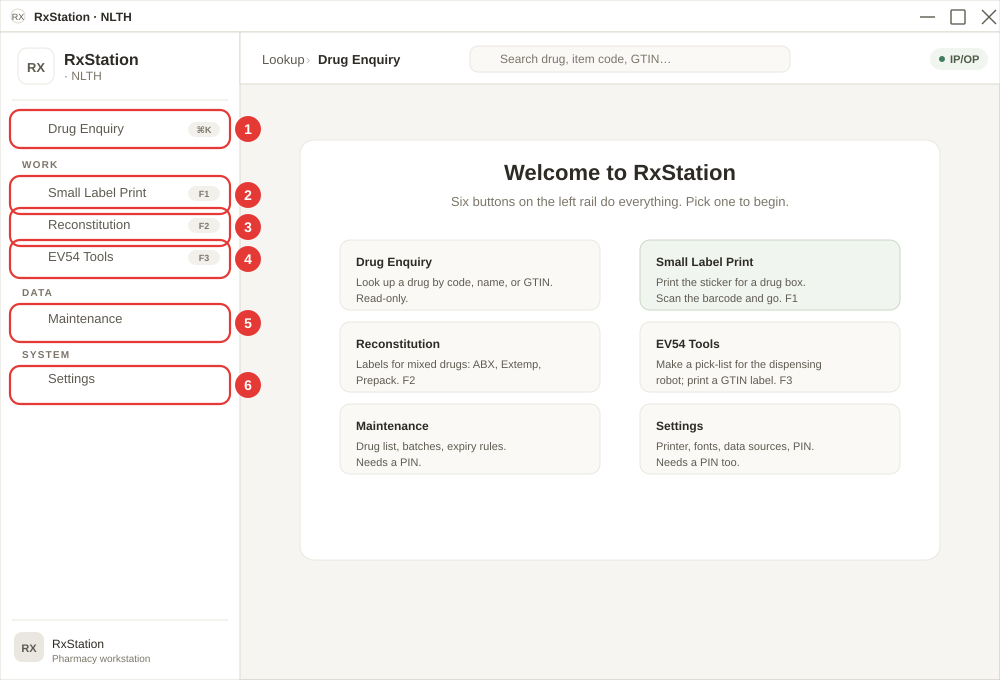

Follow the red numbers on the picture above.

**① Drug Enquiry.** Look up any drug by code, name, or GTIN. Read-only — no labels are printed from here. The keyboard shortcut is **Ctrl+K** (written as `⌘K` on the badge).

**② Small Label Print.** The page you will use most. Scan a barcode or type a 6-character item code, and RxStation prints the sticker that goes on the drug box or vial. Shortcut: **F1**.

**③ Reconstitution.** For compounded drugs — ABX, Extemporaneous, and Prepack. Each one has its own tab. Shortcut: **F2**.

**④ EV54 Tools.** Two jobs for the EV54 robot — print a pick-list when you refill the robot, or print a GTIN QR label for a bottle. Shortcut: **F3**.

**⑤ Maintenance.** Drug list, expiry rules, GTIN database, batch history. **Needs a PIN** before it lets you in (Chapter 7).

**⑥ Settings.** Printer, fonts, paper size, data sources, PIN change, feature flags. Also needs the PIN (Chapter 8).

The top bar shows a breadcrumb (`Lookup › Drug Enquiry`), a global **Search drug, item code, GTIN…** box, and a small green chip showing the current Location (usually `IP/OP`).

> **Tip:** If some of the six buttons are missing on your PC, an admin has turned them off in *Settings → Admin*. Ask the admin to turn them back on (Chapter 8b).

#### What if something goes wrong?

- **The rail shows fewer than six buttons.** An admin has hidden one in *Settings → Admin → Main Menu Pages*. See Chapter 8b.
- **F1 / F2 / F3 do nothing.** Click the rail button once with the mouse first. Some windows need the app to have keyboard focus before shortcuts work.

---

## 3. Drug Enquiry

**Drug Enquiry** is the lookup page. Type any part of a drug name, item code, or GTIN, and the table below filters as you type. It is **read-only** — no labels are printed from here. For printing, use *Small Label Print* (Chapter 4).

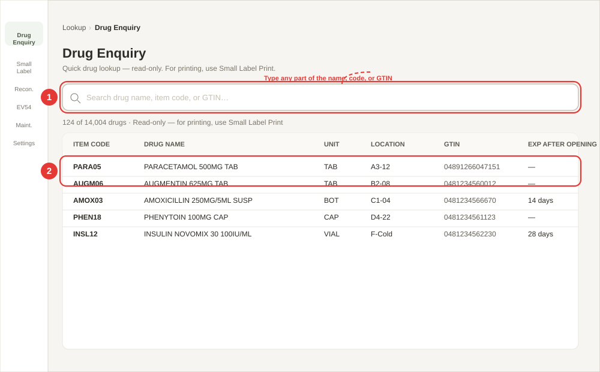

Follow the red numbers on the picture above.

**① Click inside the search box and start typing.**
The box is labelled *Search drug name, item code, or GTIN…*. The table below the box updates as you type — there is **no Enter key needed**. You can type:

- **Part of a drug name** — for example `parac` finds PARACETAMOL.
- **Part of an item code** — for example `PARA` or `PARA05`.
- **Part of a GTIN** — for example the last 6 digits of the barcode number.
- **Scan a square 2D code from one of our own labels** — the *Internal GTIN* code that RxStation prints on Prepack / Drug Reconstitution / Extemp labels (and that the Tiny 2D-code app prints). The table then shows just that drug. See *What is the 2D code?* in Chapter 5.

Upper or lower case does not matter.

**② Read the row.** Every match shows six columns:

- **Item code** — the 6-character code (copy this if you need to print a label).
- **Drug name** — the full drug name and strength.
- **Unit** — TAB, BOT, VIAL, CAP, etc.
- **Location** — the shelf/bin where the drug is kept. Shown as a pale green pill.
- **GTIN** — the 13- or 14-digit barcode number.
- **Exp after opening** — how many days the opened vial/bottle stays good for (only for drugs that have a rule).

At the top of the table you will see something like `124 of 14,004 drugs` — the first number is how many match your search, the second is the total in the drug list. A maximum of **200 rows** is shown at one time — narrow your search if your drug is not on screen.

#### What if something goes wrong?

- **"No drugs loaded. Import drug data in Maintenance."** — The drug list has not been imported yet. An admin needs to go to *Maintenance → Import Excel → Drugs (PHQ)* (see Chapter 7d).
- **"No drugs match \"…\""** — Your search string is not in the list. Try a shorter search — for example `amox` instead of `amoxicillin 250`. If you are sure the drug should be there, import the latest drug list.
- **The *Location* column shows `—`** — The drug has no shelf location recorded. Ask the senior staff to update *Maintenance → Import Excel → Item Locations*.

---

## 4. Small Label Print

The **Small Label Print** page is the one you will use most. It prints the small sticker that goes on every drug box or bottle. The page has two tabs — pick the one that fits your job.

| Tab | When to use it |
|---|---|
| **Standard Label** | For a normal drug box. Scan the barcode, or type a 6-letter item code, and press **Enter**. |
| **Short Exp (After Opening)** | For a vial or bottle that has just been opened. The app works out the new expiry date for you. |

### 4a. Standard Label — step by step

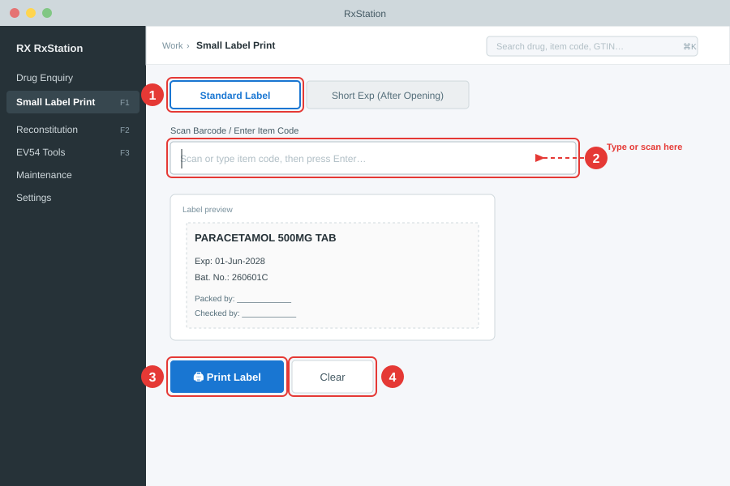

Follow the red numbers on the picture above.

**① Make sure the *Standard Label* tab is on.**
When you open the page, this tab is already on by default. If you ever see *Short Exp (After Opening)* on instead, just click **Standard Label** once.

**② Click inside the big scan box, then scan or type.**
The box is labelled *Scan Barcode / Enter Item Code*. You can use it three different ways:

- **Scan a GTIN barcode on the drug box.** Point the scanner at the barcode. The app reads the item code, the batch number, and the expiry date in one go, and a small window pops up asking *In-Patient (IP)* or *Out-Patient (OP)*. Pick one and the label prints.
- **Scan a 13-digit IP barcode.** Same — just scan. The app pulls out the item code for you.
- **Scan the square 2D code on one of our own labels** (Prepack / Drug Reconstitution / Extemp, or a Tiny 2D-code app label). It works like a GTIN barcode: the IP/OP window pops up, and the item code, batch number and expiry are filled in exactly as printed on that label. See *Scanning one of our own 2D codes* below.
- **Type a 6-letter item code.** For example `PARA05`. After you type, press **Enter** on the keyboard. The label will print as an **OP** label (no expiry date).

If you do not know the code, open **Drug Enquiry** (Chapter 3) in another window to look it up first.

**③ Click *🖨 Print Label* to print.**
If the app printed on its own after the scan, you do not have to press this button — it has already done the job. You only need to press **🖨 Print Label** when you typed or changed something (like a new expiry date) and want to send the label to the printer yourself.

**④ Click *Clear* to start a new one.**
*Clear* wipes the drug name, batch, and expiry from the screen so you can scan the next box. It does **not** delete anything from your records — it only clears the screen.

#### Typing an expiry date by hand (for IP labels only)

Some drug boxes do not have the expiry inside the barcode. When this happens, the app leaves the *Expiry date on label* box empty and waits for you.

1. Click inside the *Expiry date on label* box.
2. Type the date as **eight digits** with no spaces. Day, month, year. Example: `01062028` for 1 June 2028.
3. As soon as you finish, the app changes it to the pretty form: **01-Jun-2028**. You do not need to press Enter.
4. If you prefer, you can also type the pretty form yourself, like `01-Jun-2028`. The app will tidy the letters.
5. When you are happy, press **🖨 Print Label**.

> **OP labels never show an expiry date.** The expiry box is only there for **IP** labels, so if you picked *Out-Patient (OP)* you will not see this box at all.

#### What if something goes wrong?

You may see a short message in red. Here is what each one means:

- **"Drug not found (XXXXXX). Import your drug list via Maintenance → Import Excel → Drugs (PHQ)."** — The 6-letter code is not in the app's drug list. Ask the senior staff to import the latest drug list. Chapter 7d shows how.
- **"Could not decode barcode"** — The scanner read the barcode but the app could not understand it. Try scanning again slowly. If it keeps failing, Chapter 8 shows how to switch to the *Legacy* decoder.
- **"Unrecognised input. Enter a 6-char item code or scan a barcode."** — You typed something too short or too long. Item codes are exactly 6 letters/numbers.

When the label comes out of the printer, you will also see a small green tick — **✓ Label printed** — at the bottom of the screen. It disappears by itself after about 1.5 seconds.

#### Picking IP or OP after a GTIN scan

When you scan a GTIN barcode on a drug box, the app pops up a small window before anything is printed. It needs to know whether this sticker is for an in-patient or an out-patient.

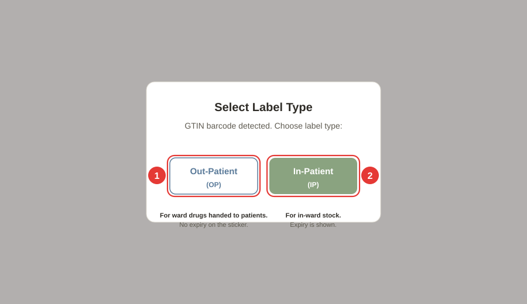

The pop-up reads *Select Label Type — GTIN barcode detected. Choose label type*. You have two choices.

**① Out-Patient (OP).** Click this button if the drug is going home with the patient. The printed label will **not** show an expiry date, even if the barcode had one. This matches HK dispensing policy for OP supplies.

**② In-Patient (IP).** Click this button if the drug stays on the ward. The printed label **will** show the expiry date read from the barcode (bold line: *Exp: DD-Mon-YYYY*).

After you click one of the two buttons:

- If the barcode had both a batch and an expiry, the label prints straight away and the screen clears for the next scan.
- If the barcode was missing the expiry (or you picked IP and the app could not read the expiry), the drug details stay on screen with an empty *Expiry date on label* box — type the date yourself (see *"Typing an expiry date by hand"* above) and click **🖨 Print Label**.

#### Scanning one of our own 2D codes

The square 2D codes printed by RxStation (Chapter 5) and by the Tiny 2D-code app carry an **Internal GTIN** — a 14-digit number starting `X04…` that is worked out from the item code. RxStation turns it straight back into the item code, so it does **not** need to be in the GTIN map. The batch number is read exactly as printed, even ones like `21113HK1`, `(B)A52921725A4` or `MIPL/A4/UII/91`.

- If the item code inside the 2D code is not in the item list, the app tries the GTIN map instead.
- If neither knows it, you see **"GTIN … is not in the GTIN map or the item list."** — nothing is printed. (Older versions guessed an item code from the last six digits; for these codes that guess was always wrong, so the app no longer does it.)
- Barcodes from drug companies work exactly as before.

#### What is printed on the sticker

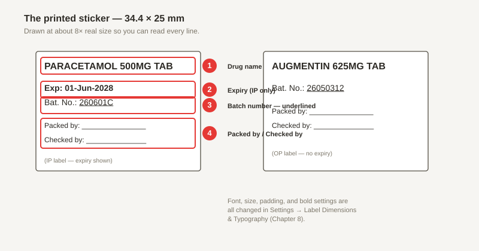

Follow the red numbers on the picture above. The **left** sticker is an IP label (has the expiry line). The **right** sticker is an OP label (no expiry line).

**① Drug name.** The top line — the full item description (for example *PARACETAMOL 500MG TAB*). Arial 6 pt bold by default.

**② Expiry date.** Shows **only on IP labels**. Reads *Exp: DD-Mon-YYYY*, bold. OP labels skip this line on purpose.

**③ Batch number.** *Bat. No.: 260601C* — underlined. If the barcode had no lot number, this line is blank so you can write the batch by hand with a pen.

**④ Packed by / Checked by.** Two empty lines at the bottom for signatures. Sign with a pen after the sticker is on the box.

The sticker is **34.4 × 25 mm** in real life. The picture above is drawn about 8 times bigger so you can read every line. To change the font, the size, the padding, or whether the drug name is bold, go to *Settings → Label Dimensions & Typography* (Chapter 8a).

### 4b. Short Exp (After Opening)

The **Short Exp** tab is for drugs that have just been opened — mostly vials, bottles of syrup, and insulin pens. The factory expiry on the box no longer applies once the seal is broken, so RxStation works out a **new, shorter expiry** from today using a pre-set rule and prints a fresh sticker.

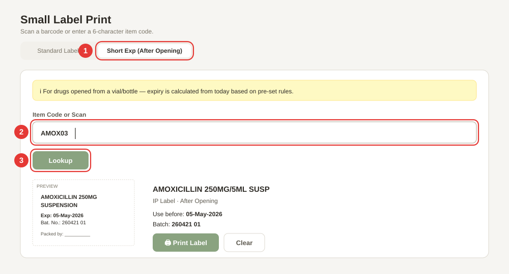

Follow the red numbers on the picture above.

**① Click the *Short Exp (After Opening)* tab.**
This tab is off by default — the app always opens on *Standard Label*. Click the tab once and you will see a yellow info banner: *ℹ For drugs opened from a vial/bottle — expiry is calculated from today based on pre-set rules.*

**② Type the 6-character item code in the *Item Code or Scan* box.**
For example `AMOX03` for Amoxicillin 250 mg/5 ml syrup. You can also scan a barcode here if the scanner is connected. The item code is **always 6 characters**.

**③ Press **Enter** or click the *Lookup* button.**
The app finds the drug, reads the "Exp After Open" rule (for example *14 days*), adds that many days to today's date, and makes a new batch number using today's date. The label prints straight away — you do **not** need a separate Print button for this.

The printed sticker is an **IP** label with:

- **Drug name** — from the drug list.
- **Exp: DD-Mon-YYYY** — today + the number of days in the rule.
- **Bat. No.: YYMMDD01** — today's date plus a two-digit sequence number (starts at 01 and goes up if you print more today).

After printing, the *✓ Label printed* tick flashes for a moment and the input box clears so you can do the next one.

#### What if something goes wrong?

- **"Item code not found: XXXXXX"** — The 6-letter code is not in the app's drug list. Ask the senior staff to import the latest drug list via *Maintenance → Import Excel → Drugs (PHQ)* (Chapter 7d).
- **"No expiry-after-open rule found for this item."** — The drug is in the list, but nobody has set up how long it lasts after opening. An admin needs to add the rule in *Maintenance → Exp After Open* (Chapter 7).
- **The new expiry looks wrong.** The rule might be out of date. Check *Maintenance → Exp After Open* — the number in the *days* column is how many days the drug stays good for after opening.

---

## 5. Reconstitution

**Reconstitution** is where you print labels for drugs that are **mixed, compounded, or repacked** in the pharmacy. Three tabs — each for a different kind of job.

| Tab | When to use it |
|---|---|
| **ABX Preparation** | Mixing an antibiotic injection (e.g. Augmentin 1.2g). |
| **Extemporaneous** | Making a liquid preparation in-house (e.g. oral syrup). |
| **Prepack** | Breaking a bulk bottle down into smaller packs (e.g. 30 tablets per bottle). |

All three tabs work the same way: pick an item code, check the numbers the app filled in, and click **🖨 Confirm & Print**. The batch number and expiry are worked out for you. Once an item is picked, a **label preview** shows exactly what will print, with a line underneath saying what the 2D code carries.

#### What is the 2D code?

Every Prepack, Drug Reconstitution and Extemp label now carries a small **square 2D code** (a GS1 DataMatrix, about 8–9 mm across) in the **bottom-right corner** — on the 50/50 Drug Reconstitution label it sits in the **lower (Use Before) half**. Nothing else on the label changes. The code holds:

- the **Internal GTIN** — the item code turned into a 14-digit number, plus the **pack volume** (30, 60, 120, 240 or 480 mL) when the item's row in *Maintenance → Products* clearly says so (see Chapter 7c);
- the **Use Before** date, exactly as printed;
- the **batch number**, exactly as printed.

BCS and RxStation can scan it, so nobody has to type the item code, batch or expiry again, and you do not need a second sticker from the Tiny 2D-code app. The line under the preview reads, for example, *2D code: (01)00425873440010(17)270419(10)PP-26101901*.

The app leaves the 2D code off — and asks before printing — when it cannot carry what the label says:

- **"Item code … cannot be made into an Internal GTIN"** — the code is not 6 letters/digits.
- **"The Use Before date … is not a date the 2D code can carry (use DD/MM/YYYY)"** — usually a mistyped override date on the Prepack tab. Re-type it as `DD/MM/YYYY`.
- **"The batch number must be upper case with no spaces"** / **"A Lot cannot contain …"** — the item's prefix has a lower-case letter, space or symbol. Fix the prefix in *Maintenance → Products*.
- **"The label text does not fit beside the 2D code at the current font sizes"** — the drug name or other text is too long for the font sizes set in *Settings → Label Layout*. Print without the code, or ask an admin to reduce the font sizes.

Click **OK** to print the label without the 2D code, or **Cancel** to fix the problem first. An admin can turn the 2D code off for every label in *Settings → Label Layout* (Chapter 8a).

### 5a. ABX Preparation

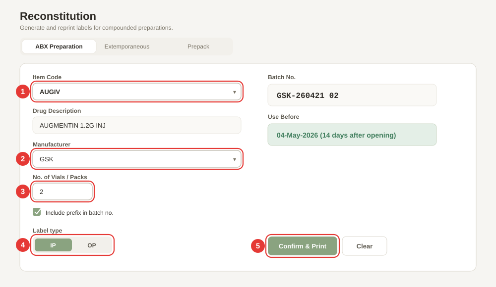

Follow the red numbers on the picture above.

**① Choose an item code from the *Item Code* drop-down.**
Click the arrow on the right of the box and pick the antibiotic you are mixing (for example *AUGIV* for Augmentin 1.2g Inj). As soon as you pick, the app fills in **Drug Description** below from the item list (*Drug (PHQ)*). If the code is not in the item list, the item code is shown with *⚠ Not in item list* and the app asks before printing.

**② Choose a manufacturer from the *Manufacturer* drop-down.**
Only the manufacturers with an **Active** expiry rule for this drug appear here. If the list is empty, an admin needs to add an expiry rule in *Maintenance → Expiry Rules*. The **Use Before** date on the right side is worked out from this manufacturer's shelf-life rule (for example *14 days after opening*).

**③ Set the *No. of Vials / Packs*.**
Type the number of vials you are mixing today. The app prints this many small labels **plus one extra spare** for the batch sheet — so *No. of Vials = 2* means **3 labels** will come out of the printer.

**④ Pick the label type — *IP* or *OP*.**
Use the toggle under *Label type*. IP labels show the expiry line; OP labels do not. Most ward antibiotics are IP.

**⑤ Check the preview, then click *🖨 Confirm & Print*.**
The *Reconstitution label preview* shows the bottle label with its 2D code in the lower half (see *What is the 2D code?* above). The labels print, a new row is added to Batch History (*Maintenance → Batch History*), and this item's batch counter goes up by one for next time. You will see *✓ Labels printed & record saved!* flash at the top of the card.

The **Batch No.** field shows how the batch will look, for example `A457-26101902` — the item's prefix + today's date + a two-digit counter. Each item has its own counter that restarts at 01 every day, so printing *AUGM06* (`A457-26101901`) and then *AUGM02* gives `A156-26101901`, not `…02`. Untick *Include prefix in batch no.* if you do not want the manufacturer prefix on the label.

#### What if something goes wrong?

- **"Please select an item code."** — You clicked *Confirm & Print* without picking an item. Pick one first.
- **"Please select a manufacturer."** — Same — pick a manufacturer from the drop-down.
- **"Could not calculate expiry — check expiry rules in Maintenance."** — No Active expiry rule exists for this drug + manufacturer pair. Ask an admin to add one in *Maintenance → Expiry Rules*.

### 5b. Extemporaneous

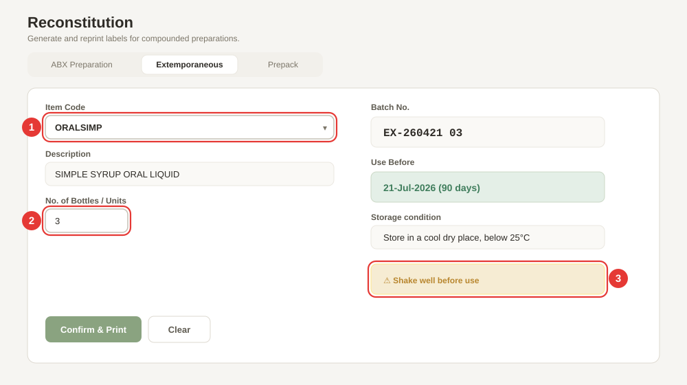

Follow the red numbers on the picture above.

**① Choose an item code from the *Item Code* drop-down.**
For example *ORALSIMP* for *SIMPLE SYRUP ORAL LIQUID*. The app fills in the **Description** automatically. The **Batch No.** and **Use Before** on the right update at the same time, based on the Expiry Rule for this item.

**② Type the *No. of Bottles / Units*.**
Type how many bottles/units you are making. The app prints **enough copies so that each bottle gets 2 labels** (one for the bottle, one for the batch sheet). For 3 bottles you will get 6 labels.

**③ Read the storage + warning block on the right.**
Below the *Use Before* date, the app shows the **Storage condition** (for example *Store in a cool dry place, below 25°C*) and any **Warning** from the expiry rule (for example *⚠ Shake well before use*). These come from *Maintenance → Expiry Rules* — check them before you print, because they will appear on the printed label.

**To finish:** check the *Label preview* (the 2D code is in the bottom-right corner) and click **🖨 Confirm & Print**. The labels print and a Batch History record is saved. Click **Clear** to reset the form for the next job.

#### What if something goes wrong?

- **"Please select an item code."** — Pick one from the drop-down.
- **"No expiry rule found — add one in Maintenance."** — The item has no Active Expiry Rule. Ask an admin to add one in *Maintenance → Expiry Rules*.
- **The storage/warning text on the printed label is wrong.** Edit the rule in *Maintenance → Expiry Rules* and set the correct *Storage* and *Warning* fields, then try again.

### 5c. Prepack

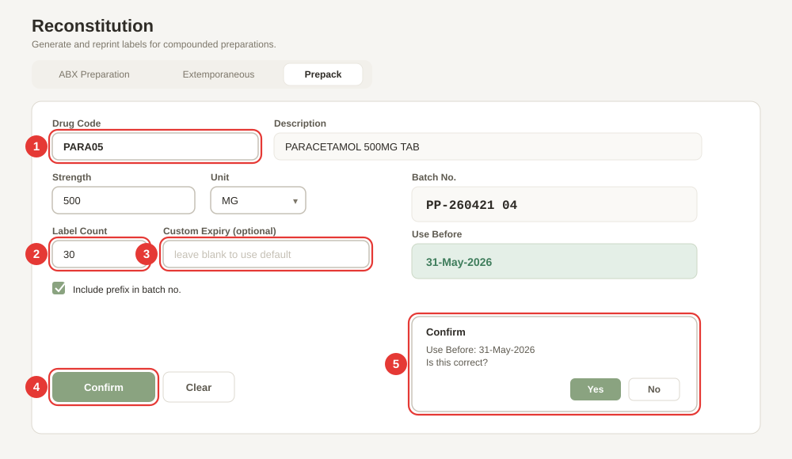

Follow the red numbers on the picture above.

**① Choose a drug code from the *Drug Code* drop-down — or scan.**
For example *PARA01* for Paracetamol 500mg tab. The **Description** field fills in on the right.
Instead of the drop-down you can click the **Scan or Type Code** box at the top and scan the bulk bottle's barcode, scan the 2D code on an earlier prepack label, or type the drug code, then press **Enter**. The drug must be on the Prepack list, otherwise you see *"XXXXXX is not on the Prepack list."*

**② Type the *Strength*.**
The strength shown on the label, for example `500`. This will be added to the description, so the sticker reads *PARACETAMOL 500MG TAB 500MG*. Leave it blank if the description already has the strength in it.

**③ Choose the *Unit*.**
Pick from **MG**, **MCG**, **G**, **ML**, **IU**, **%**, or **MMOL** in the drop-down.

**④ Click *🖨 Confirm & Print*.**
The app asks you one more time: *Use Before: DD-Mon-YYYY — Is this correct?*. This is the **double-check popup** (red callout 5 on the picture).

**⑤ The Confirm popup.**
- Click **OK / Yes** if the use-before date looks right → the labels print.
- Click **Cancel / No** if you want to type a different expiry → a new *Override Use Before Date* box appears. Type the correct date as `DD/MM/YYYY` and click *Confirm* to print with your override. The label preview and the 2D code use your override date.

Before you hit Confirm, tidy up the small details on the left:

- **Number of Labels** — how many labels you want out of the printer for this prepack run.
- **Include prefix in batch no.** — tick on to get a prefix (for example `PP-260421 04`); tick off for a plain `260421 04`.

#### What if something goes wrong?

- **"Please select a drug code."** — Pick one from the drop-down first.
- **"No expiry date — check expiry rules or enter one manually."** — The drug has no Active Expiry Rule **and** you did not type a *Custom Expiry*. Either add a rule in *Maintenance → Expiry Rules*, or type a date in *Custom Expiry (optional)*.

---

## 6. EV54 Tools

**EV54 Tools** help you work with the EV54 dispensing robot. Two tabs — one to make a pick-list before you refill the robot, and one to print a QR-code label for a bottle.

| Tab | When to use it |
|---|---|
| **Print Pick List** | Before you refill the EV54. Build a list of drug codes + quantities and print a sorted pick-list on A4 paper. |
| **Print GTIN Label** | For a bulk bottle that you will feed into the robot. Prints a QR code of the drug's GTIN plus the item code. |

### 6a. Print Pick List

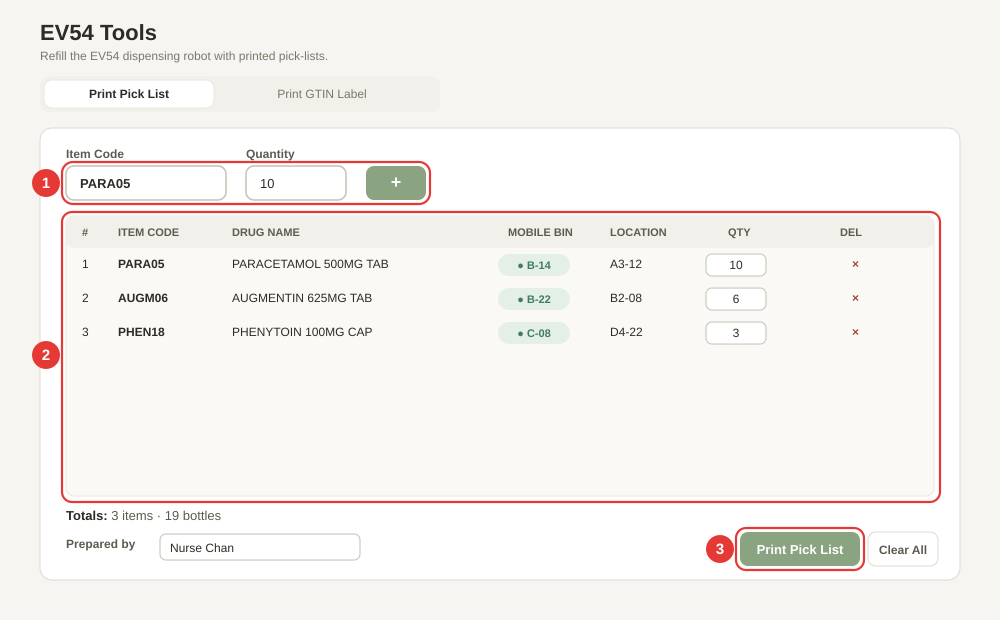

Follow the red numbers on the picture above.

**① Add items one at a time.**
- Type the 6-character **Item Code** (for example `PARA05`) — or scan a barcode or one of our own 2D codes — and press **Enter** → the cursor jumps to the Quantity box.
- Type the **Quantity** (how many bottles you will pick) and press **Enter** → the row is added to the list below.
- The cursor jumps back to the Item Code box so you can add the next drug.
- If you add the **same item code twice**, the app **merges** the two entries and highlights the row in blue for a moment — it does not create a duplicate.

**② Check the list in the middle of the page.**
Every added drug shows up as a row: **# · Code · Drug name · Location · Qty · ×**.
- The **Location** column shows the pick location. If the drug lives on the **mobile refill shelf**, you see a green pill like *● B-14* — this takes priority over the normal shelf location.
- The **Qty** box on each row is editable — click it to change the quantity without deleting the row.
- Click the red **×** at the right end of a row to delete that drug.
- **Clear All** wipes every row (asks you first).

**③ Click *🖨 Print* to print the pick-list.**
Type your name in the **Prepared by** box first (it goes on the printed A4 page). Then click **🖨 Print**. The app sorts all the rows by location before printing so you can walk the shelves in order without backtracking. You will see the totals at the bottom: for example *3 items · 19 bottles · Plastic containers required: 3*.

#### What if something goes wrong?

- **"Item code must be 6 characters"** — Your code is too short or too long. Item codes are exactly 6 characters.
- **"Item code \"XXXXXX\" not found in PHQ data"** — The code is not in the drug list. Import the latest drug list (Chapter 7d), or check for a typo.
- **"XXXXXX is not on the EV54 drug list"** — The code is in the drug list but the admin has restricted pick-lists to the EV54 allowlist. Ask an admin to either add this drug to *Maintenance → EV54 Drugs*, or turn off the restriction in *Maintenance → EV54 Allowlist*.
- **"Quantity must be at least 1"** — Type a whole number of 1 or more.

### 6b. Print GTIN Label

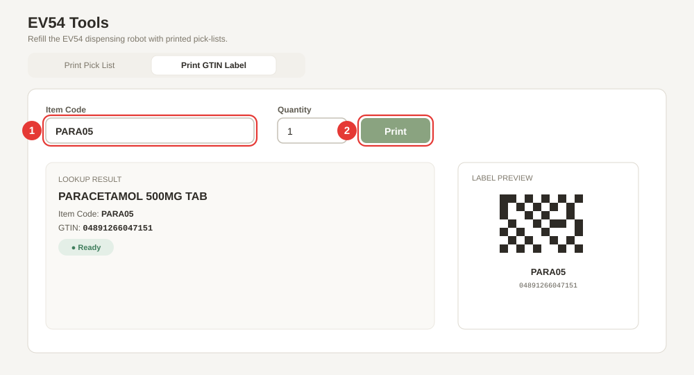

Follow the red numbers on the picture above.

**① Type the 6-character item code in the *Item Code* box.**
For example `PARA05`. As soon as you finish typing (after the 6th character), the app looks up the drug in the drug list **and** the GTIN in the GTIN map. A small preview card appears below showing the drug name, item code, and GTIN. A green pill reads *● Ready* once both are found.

**② Set the *Quantity* and click *🖨 Print Label*.**
- Type how many labels you want (1 to 99).
- Click **🖨 Print Label** (or just press **Enter** in the item code box once the preview is green).

If you scan one of our own square 2D codes here, the app looks up the item and prints the drug's GTIN from the GTIN map — not the Internal GTIN, which only our own systems understand.

The label is a small sticker with a **QR code** of the full GTIN and the **item code** in text below the QR. The QR is sized automatically to fill the label; you can tweak it in *Settings → GTIN QR Label* if you need smaller text.

#### What if something goes wrong?

- **"Item code not found in drug list."** — The 6-letter code is not in the drug list. Import the latest drug list (Chapter 7d).
- **"No GTIN found for this item code. Check GTIN map in Maintenance."** — The drug is in the list, but it has no GTIN recorded. Reload the GTIN database in *Maintenance → GTIN Database → Reload from DB*.
- **The QR code is too small / too big on the label.** Go to *Settings → GTIN QR Label* and type a QR size in mm (0 = auto-fit).

---

## 7. Maintenance

**Maintenance** is where the drug list, batches, expiry rules, and GTIN data live. It is **PIN-protected** — only senior staff should use it.

### 7a. Unlocking Maintenance

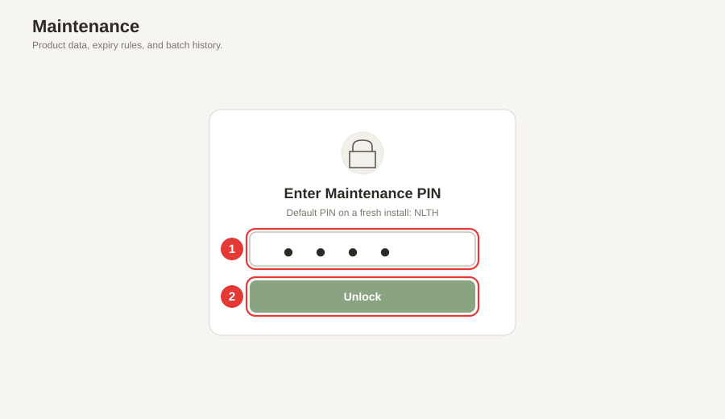

When you click **Maintenance** on the left rail for the first time, the app shows the PIN screen.

**① Type the PIN in the password box.**
The **default PIN on a fresh install is `NLTH`** (four capital letters). The box hides the letters with dots as you type.

**② Click *Unlock*.**
- If the PIN is right → the Maintenance page opens.
- If the PIN is wrong → a red message shakes on screen: *Incorrect PIN. Please try again.* The box clears so you can try again.

> **Change the default PIN on first use.** `NLTH` is printed in this guide, so anyone who reads the guide knows it. Go to *Settings → Change Maintenance PIN* (Chapter 8a) and pick a PIN only your team knows. If you lose the new PIN, an admin will need to reset it.

### 7b. Finding your way around

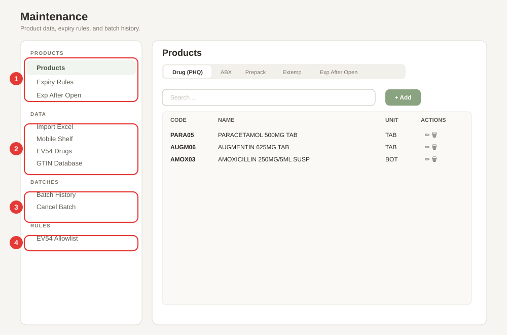

Once you are in, Maintenance is split into **four groups** down the left side. Follow the red numbers above.

**① PRODUCTS group.** The drug lists that the rest of the app reads from.
- **Products** — the main drug list (PHQ) plus the ABX / Prepack / Extemp / Exp-After-Open mini-lists. Use the tabs at the top of the page to switch between them.
- **Expiry Rules** — shelf-life rules per drug and manufacturer.
- **Exp After Open** — how many days a drug is good for after opening (used by *Small Label Print → Short Exp*).

**② DATA group.** Read-only viewers and the Excel importer.
- **Import Excel** — bring a spreadsheet into the app. **This is where fresh PHQ / GTIN / Location lists go.** See 7d below.
- **Mobile Shelf** — read-only table of drugs on the mobile refill shelf.
- **EV54 Drugs** — read-only table of drugs approved for the EV54 robot.
- **GTIN Database** — read-only GTIN → item code map. Has a *Reload from DB* button to refresh it from the Access `.accdb` file.

**③ BATCHES group.** The audit trail for every printed batch.
- **Batch History** — list of every batch printed from the Reconstitution page.
- **Cancel Batch** — mark a batch as cancelled (keeps the record but flags it as void).

**④ RULES group.** Feature rules.
- **EV54 Allowlist** — turn on/off the rule that says "only drugs on the EV54 list can go on a pick-list". See 6a.

### 7c. The Products sub-tabs

Click **Products** and the main area shows five mini-tabs across the top: **Drug (PHQ) · ABX · Prepack · Extemp · Exp After Open**. Each tab shows a searchable table with **+ Add**, edit (✏️), and delete (🗑️) buttons. Use these when you want to add or fix a single item by hand.

**Pack volume for the 2D code.** If a liquid always comes in one of the listed volumes, type it as a number followed by `ML` — for example `60ML` — in the row's **Pack Size** (ABX), **Volume** (Extemp) or **Unit** (Prepack) field. The 2D code then records 30, 60, 120, 240 or 480 mL. Anything else (blank, `100ML`, `TAB`, `60` without `ML`) records no volume — that is fine and still scans to the right item.

Drug descriptions always come from the **Drug (PHQ)** item list. The ABX, Prepack, Extemp and Exp After Open tabs show that description next to each code (or *⚠ Not in item list*); to change the wording on a label, fix the item list, not these tabs.

For bulk changes (hundreds of drugs at once), use **Import Excel** instead — it is faster and less error-prone.

### 7d. Import Excel — the most common Maintenance job

When a new drug list, GTIN list, or location list arrives, this is where you bring it in.

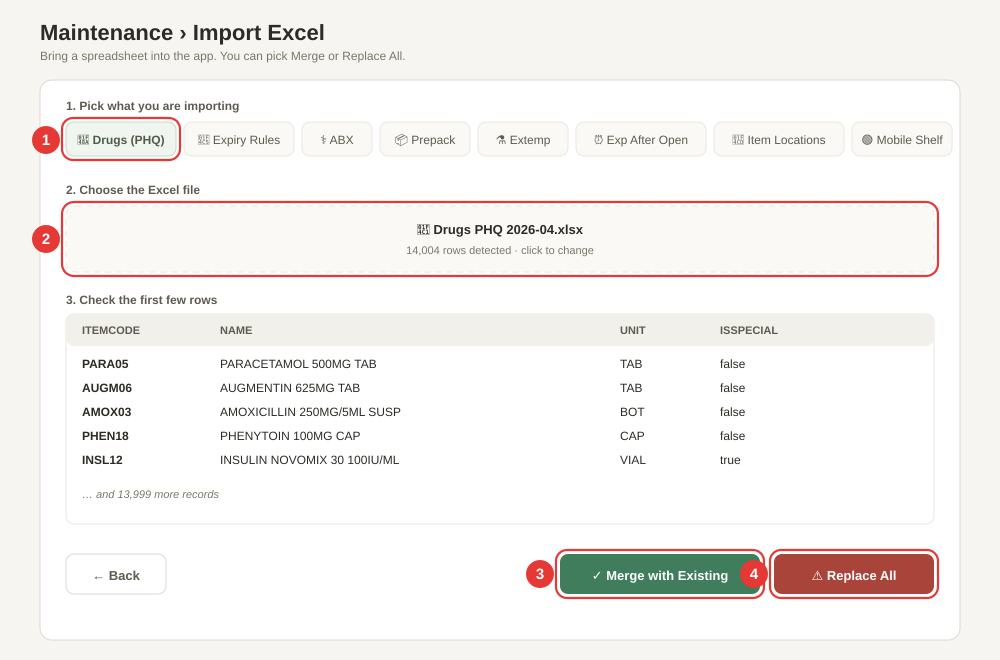

Follow the red numbers on the picture above.

**① Pick what you are importing.**
Click one of the pill buttons along the top: **💊 Drugs (PHQ)**, **📅 Expiry Rules**, **⚕️ ABX**, **📦 Prepack**, **⚗️ Extemp**, **⏰ Exp After Open**, **📍 Item Locations**, **🟢 Mobile Shelf**, or **🤖 EV54 Drugs**. Each pill tells the app how to read the columns in your file.

**② Choose the Excel file.**
Click the dashed upload box (labelled *Select Excel File (.xlsx)*) and pick the `.xlsx` file. The app reads the first sheet, pulls out the rows it recognises, and shows you:
- The sheet name (for example *Drugs PHQ 2026-04.xlsx*).
- How many rows it found (for example *14,004 rows detected*).
- The **first five rows** in a preview table so you can see the data before you commit.

If the row count looks wildly wrong, click **← Back** and pick a different file.

**③ Click *✓ Merge with Existing*.**
Adds your new rows to the current list — **nothing is deleted**. Use this to *add* a few new drugs without losing the existing ones. A green bar reads *✓ Successfully imported N records. (Merged with existing)*.

**④ Or click *⚠️ Replace All*.**
**Deletes the current list** and saves your new file in its place. Use this when the new spreadsheet is the complete, up-to-date list and the old one is out of date. A green bar reads *✓ Successfully imported N records. (Replaced all)*.

> **Replace All cannot be undone.** Export a backup first in *Settings → Data Backup & Restore → ⬇ Export Backup* (Chapter 8a) before you click Replace All.

#### What if something goes wrong?

- **"✗ No data found in Excel file"** — The file is empty or the app could not read it. Open it in Excel first to check it has at least one sheet with data.
- **"✗ No valid data found for selected type"** — The column headers in the spreadsheet do not match what the app expects. Check the blue *Expected columns* hint on the import page — for *Drugs (PHQ)* the columns are `itemCode, name, unit, isSpecial`.
- **"✗ Error: …"** — A Read or Parse error from the file itself. Save the file as `.xlsx` (not `.xls` or `.csv`) and try again.

---

## 8. Settings

**Settings** is split into two tabs at the top: **General** and **Admin**. Both tabs need the Maintenance PIN to open the page. The Admin tab then needs a second, stronger PIN to turn feature flags on/off.

### 8a. General tab

Click **General** at the top. Scroll from top to bottom — each card controls one part of the app.

#### Data Sources

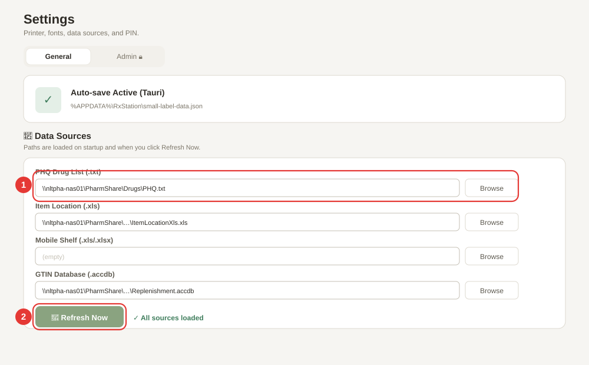

Follow the red numbers on the picture above.

**① Type or browse to the file paths.**
These are the files RxStation reads from when it starts up. Each row has a file-path box and a *Browse…* button.

- **PHQ Drug List (.txt)** — the pipe-delimited drug list.
- **Item Location (.xls)** — the shelf locations spreadsheet.
- **Mobile Shelf (.xls / .xlsx)** — the mobile refill shelf spreadsheet.
- **EV54 Drugs (.xls / .xlsx)** — the EV54 robot drug list.
- **GTIN Database (.accdb)** — the Microsoft Access file with the GTIN → item code map.

Typical paths look like `\\nltpha-nas01\PharmShare\Drugs\PHQ.txt`. Paste the full UNC path or click *Browse…* to pick the file.

**② Click *🔄 Refresh Now*.**
Reloads every file path above right now. A green tick appears next to the button listing what was loaded (for example *✓ Refreshed: PHQ drugs, Locations, GTIN*). If a path is wrong, you will see a red ✗ line instead.

#### General

Under the Data Sources card you will find the **⚙️ General** card:

- **Location** — `IP/OP`, `EC`, or `SM`. This decides which batch counter is used when you print a reconstitution label. Default: `IP/OP`.
- **Thermal Printer** — the Windows printer name. On a Tauri desktop build, a drop-down shows every installed printer. Default: `Thermal GX420t - PMS`.
- **PHQ Database Path** — optional `.mdb` path for a legacy PHQ lookup.
- **Show print dialog** — tick this on if you want Windows to ask *which printer?* before each label; untick for silent printing to the default printer.
- **🖨️ Silent print (PowerShell + System.Drawing)** — desktop app only. When ticked, labels are drawn pixel-perfect via GDI and sent straight to the printer.

Remember to click **Save settings** at the top of the page (top-right, green button). It turns into *✓ Saved* for a moment so you know it worked.

#### Barcode Decoder Method

One card lets you pick **how barcodes are parsed**:

- **GS1 AI Parser** *(default, recommended)* — reads Application Identifiers `(01)(10)(17)` in any order. Works with QR, Data Matrix, and GS1-128.
- **Legacy (P0–P6)** — the old positional parser. Only use this if your scanner outputs a non-standard format that the GS1 parser cannot handle.

If your scanner keeps giving *"Could not decode barcode"* errors (Chapter 4a), switch to Legacy and try again.

#### Label Dimensions & Typography

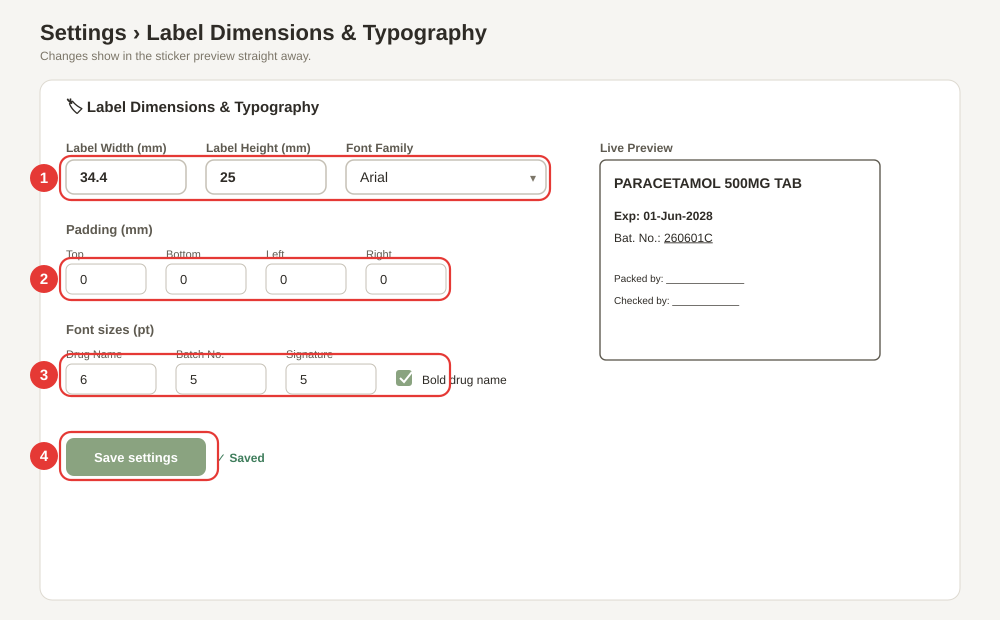

Follow the red numbers on the picture above.

**① Label Width, Height, and Font Family.**
- **Label Width (mm)** — the sticker width. Default **34.4**.
- **Label Height (mm)** — the sticker height. Default **25**.
- **Font Family** — Arial (default), Helvetica, Calibri, Tahoma, Verdana, Courier New, or Times New Roman.

Only change width / height if your label stock is a different size, otherwise the printed text will not line up.

**② Padding (mm) — Top / Bottom / Left / Right.**
Empty space on each edge of the sticker. All four default to **0 mm**. Increase these if the printer is cutting off the top or left of the text; decrease them if the text is too squashed against one edge.

**③ Font sizes (pt) and *Bold drug name*.**
- **Drug Name** — default **6 pt** (and bold by default).
- **Batch No.** — default **5 pt**.
- **Signature** — default **5 pt**.
- **Bold drug name** — tick on by default.

The card finishes with a grey hint line: *Default: 34.4 × 25 mm · Arial · Drug 6pt bold · Batch 5pt · Sign 5pt · No padding* — handy if you want to reset after experimenting.

**④ Click *Save settings*.**
At the top-right of the page. The button flashes *✓ Saved* for two seconds. Your next printed label uses the new dimensions.

#### 2D Code on Prepack / Reconstitution / Extemp Labels

One tick box: **Print the Internal GTIN 2D code (GS1 DataMatrix)** — **on** by default. Untick it (and click **Save settings**) to print these labels exactly as before, without the square code. The *Drug Reconstitution* live preview above shows where the code sits; it is drawn at 3 printer dots per square for the GX420t, so do not scale it.

#### GTIN QR Label

A small card for the QR label printed by *EV54 Tools → Print GTIN Label* (Chapter 6b):

- **QR Code Size (mm)** — 0 means auto-fit (fill the label).
- **Item Code Font Size (pt)** — default **5 pt**.

#### Change Maintenance PIN

Three boxes side-by-side: *Current PIN · New PIN · Confirm New PIN*. Type them all and click **Change PIN**. You will see *✓ PIN changed successfully.* in green. Rules:
- The current PIN must match the one already on the system.
- The two new PINs must match.
- The new PIN must be **at least 4 characters**.

If any of these fail you get a red message: *Current PIN is incorrect.* / *New PINs do not match.* / *PIN must be at least 4 characters.*

#### Data Backup & Restore

Two buttons:
- **⬇ Export Backup** — downloads a JSON file named `small-label-backup-YYYY-MM-DD.json` with all of the app's data (drugs, rules, records, settings). Save this file somewhere safe.
- **⬆ Import Backup** — loads a previously exported JSON file. Asks you to refresh the page after.

Export a backup **before** any large import (especially *Replace All* in Chapter 7d) so you can roll back if something goes wrong.

### 8b. Admin tab

The **Admin** tab hides app features you do not use. It needs a separate PIN on top of the main Settings PIN.

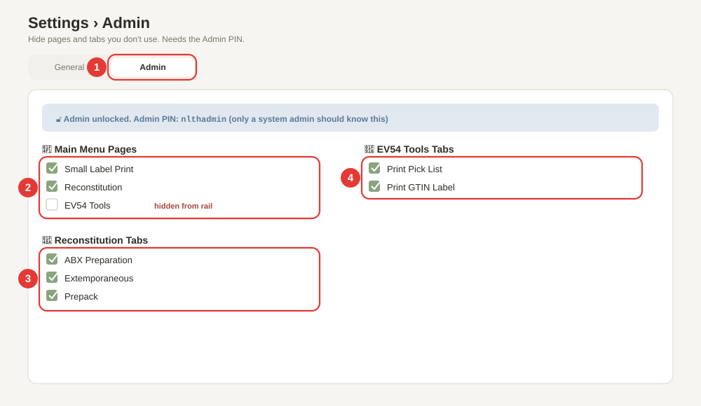

Follow the red numbers on the picture above.

**① Click the *Admin* tab at the top.**
It reads *Admin 🔒* when locked. A small card pops up asking for the **Admin PIN**. Type `nlthadmin` (all lowercase) and click **Unlock Admin**. Only a system admin should know this PIN — do not share it with ward staff.

**② Turn *Main Menu Pages* on or off.**
A list of the three main work pages:
- **Small Label Print**
- **Reconstitution**
- **EV54 Tools**

Untick a box → the matching button **disappears from the left rail**. Tick it back → the button reappears. Use this to hide features that are not used on this PC.

**③ Turn *Reconstitution Tabs* on or off.**
Inside the Reconstitution page, you can hide individual tabs:
- **ABX Preparation**
- **Extemporaneous**
- **Prepack**

Untick the ones you do not need.

**④ Turn *EV54 Tools Tabs* on or off.**
Inside EV54 Tools:
- **Print Pick List**
- **Print GTIN Label**

Changes take effect straight away — no need to click Save.

#### What if something goes wrong?

- **"Incorrect PIN"** (on the admin PIN card) — The admin PIN is `nlthadmin` (all lowercase, no spaces). Double-check your keyboard (Caps Lock off).
- **I turned *Small Label Print* off by mistake — how do I get it back?** Unlock Admin again and tick the box. If you have lost the admin PIN, see your system administrator.

---

## 9. Everyday Recipes

One page per common job — each recipe is a short numbered list that points you at the right chapter for the details.

### 9a. Print an OP label (no expiry)

1. Click **Small Label Print** on the left rail, or press **F1**.
2. Make sure the **Standard Label** tab is on.
3. Click inside the scan box and type the **6-character item code** (for example `PARA05`).
4. Press **Enter**. The label prints as an **OP label** (no expiry).
5. Full details: Chapter 4a.

### 9b. Print an IP label from a GTIN scan

1. Click **Small Label Print** on the left rail (or **F1**).
2. On the **Standard Label** tab, click inside the scan box.
3. **Scan the GTIN barcode** on the drug box.
4. When the pop-up appears, click **In-Patient (IP)**.
5. If the barcode had an expiry date, the label prints straight away. If the expiry is empty, type it in as `DDMMYYYY` (eight digits) and click **🖨 Print Label**.
6. Full details: Chapter 4a + the *IP/OP selection* sub-section.

### 9c. Print a short-expiry label after opening a vial

1. Click **Small Label Print** (or **F1**).
2. Click the **Short Exp (After Opening)** tab.
3. Type or scan the **6-character item code** in the scan box.
4. Press **Enter** (or click **Lookup**). The new expiry is worked out from today + the "Exp After Open" rule, and the label prints straight away.
5. Full details: Chapter 4b.

### 9d. Import a new drug list from Excel

1. Click **Maintenance** on the left rail.
2. Type the Maintenance PIN and click **Unlock**.
3. Click **Import Excel** in the sidebar (DATA group).
4. Click the **💊 Drugs (PHQ)** pill.
5. Click the dashed upload box and pick the `.xlsx` file.
6. Check the preview (sheet name, row count, first five rows).
7. Click **✓ Merge with Existing** (keeps current rows) or **⚠️ Replace All** (deletes current rows first).
8. Full details: Chapter 7d. **Always export a backup first** — Chapter 9e.

### 9e. Back up your data

1. Click **Settings** on the left rail.
2. Type the Maintenance PIN and click **Unlock**.
3. Stay on the **General** tab.
4. Scroll down to the **💾 Data Backup & Restore** card.
5. Click **⬇ Export Backup**. Your browser saves a file called `small-label-backup-YYYY-MM-DD.json`.
6. Save the file somewhere safe (a network drive, not this PC only).
7. Full details: Chapter 8a → *Data Backup & Restore*.

### 9f. Change the thermal printer

1. Click **Settings** on the left rail and unlock with the PIN.
2. Stay on the **General** tab.
3. Scroll to the **⚙️ General** card.
4. Under **Thermal Printer**, pick the new printer from the drop-down (or type its name if the drop-down is empty).
5. Click **Save settings** at the top-right of the page.
6. Print a test label from *Small Label Print* to check the new printer.
7. Full details: Chapter 8a → *General*.

---

## 10. When Things Go Wrong

Every red message in RxStation has a meaning. If you see one of the messages below on screen, this table tells you what it means and what to do.

| The app says… | It means… | What to do |
|---|---|---|
| Drug not found (XXXXXX). Import your drug list via Maintenance → Import Excel → Drugs (PHQ). | The 6-letter code is not in the drug list. | Ask an admin to import the latest drug list. Chapter 7d. |
| Could not decode barcode | The scanner read the label but the app cannot parse it. | Try again slowly. If it keeps failing, switch to the **Legacy** decoder in *Settings → Barcode Decoder Method*. Chapter 8a. |
| Unrecognised input. Enter a 6-char item code or scan a barcode. | What you typed is the wrong length. | Item codes are exactly 6 characters. Type or scan again. |
| Item code not found: XXXXXX | Short Exp could not find the 6-letter code in the drug list. | Import the latest drug list (Chapter 7d) or check for a typo. |
| No expiry-after-open rule found for this item. | Short Exp needs a rule for how long the drug lasts after opening. | *Maintenance → Exp After Open* — add the item and the number of days. Chapter 7. |
| Incorrect PIN. Please try again. | The Maintenance PIN you typed is wrong. | Default PIN is `NLTH`. If your team changed it and you lost the new one, ask a system admin. |
| Incorrect PIN *(on the Admin card in Settings)* | The Admin PIN is wrong. | Admin PIN is `nlthadmin` (all lowercase). Only system admins should know this. |
| Please select an item code. | You clicked *Confirm & Print* on a Reconstitution tab without picking an item. | Pick an item code from the drop-down first. Chapter 5. |
| Please select a manufacturer. | ABX tab — no manufacturer chosen. | Pick one from the Manufacturer drop-down. Chapter 5a. |
| Could not calculate expiry — check expiry rules in Maintenance. | No Active expiry rule exists for the drug + manufacturer pair. | *Maintenance → Expiry Rules* — add an Active rule. Chapter 7. |
| No expiry rule found — add one in Maintenance. | Extemp / Prepack — the drug has no Active Expiry Rule. | *Maintenance → Expiry Rules* — add a rule. Chapter 7. |
| No expiry date — check expiry rules or enter one manually. | Prepack — no rule and no custom expiry. | Add a rule, or type a date in *Custom Expiry (optional)*. Chapter 5c. |
| GTIN … is not in the GTIN map or the item list. | Small Label Print — the scanned code starts `X04…` (an Internal GTIN) but is not for an item in the item list, and the GTIN map does not know it either. | Check the label is one of ours and the drug list is up to date (Chapter 7d). The app never guesses an item code for these codes. |
| XXXXXX is not on the Prepack list. | Prepack *Scan or Type Code* — the scanned or typed drug is not set up for prepacking. | Pick from the drop-down, or add it in *Maintenance → Products → Prepack*. |
| No 2D code on this label: … | Reconstitution tabs — the 2D code cannot carry what the label says. | See *What is the 2D code?* in Chapter 5. |
| The label text does not fit beside the 2D code at the current font sizes … | Reconstitution tabs — with these font sizes the 2D code would push text off the label. | Print without the code, or reduce the font sizes in *Settings → Label Layout*. |
| Item code must be 6 characters | EV54 pick-list — your code is the wrong length. | Item codes are exactly 6 characters. Chapter 6a. |
| Item code "XXXXXX" not found in PHQ data | EV54 — the code is not in the drug list. | Import the latest drug list. Chapter 7d. |
| XXXXXX is not on the EV54 drug list | EV54 pick-list is restricted to the EV54 allowlist. | *Maintenance → EV54 Drugs* — add the item, or turn off the restriction in *Maintenance → EV54 Allowlist*. Chapter 7. |
| Quantity must be at least 1 | EV54 pick-list quantity is blank or zero. | Type a whole number of 1 or more. |
| Item code not found in drug list. | GTIN Label — the code is not in the drug list. | Import the drug list. Chapter 7d. |
| No GTIN found for this item code. Check GTIN map in Maintenance. | The drug is in the list but has no GTIN. | *Maintenance → GTIN Database → Reload from DB*. Chapter 7b. |
| Current PIN is incorrect. | Change PIN — the current PIN you typed is wrong. | Try again. If lost, ask a system admin. |
| New PINs do not match. | Change PIN — the two new PINs differ. | Type the same PIN in both *New PIN* and *Confirm New PIN*. |
| PIN must be at least 4 characters. | Change PIN — new PIN is too short. | Pick a PIN of 4 characters or more. |
| ✗ No data found in Excel file | Import Excel — the file is empty or unreadable. | Open in Excel to check it has data, save as `.xlsx`, try again. |
| ✗ No valid data found for selected type | Import Excel — column headers do not match the expected shape. | See the blue *Expected columns* hint on the import page. Chapter 7d. |
| ✗ Import failed — invalid file format. | Restore Backup — the JSON file is not a valid RxStation backup. | Make sure you picked a file named `small-label-backup-*.json`. Chapter 8a. |

---

## 11. Keyboard Shortcuts

A handful of shortcuts work everywhere in RxStation. The ones with a badge on the left rail are the important ones.

| Shortcut | What it does |
|---|---|
| **F1** | Jump to **Small Label Print**. |
| **F2** | Jump to **Reconstitution**. |
| **F3** | Jump to **EV54 Tools**. |
| **Ctrl+K** (or **⌘K** on macOS) | Focus the **global search** box in the top bar. |
| **Enter** | In any scan/input box — submit what you typed (item code, barcode, quantity). |
| **Enter** (in the EV54 pick-list *Item Code* box) | Jump to the **Quantity** box. |
| **Enter** (in the EV54 pick-list *Quantity* box) | Add the row to the list and jump back to *Item Code*. |

> **Tip:** If F1 / F2 / F3 do nothing, click once on the app window to give it keyboard focus, then try again. These shortcuts only work while RxStation is the active window.
